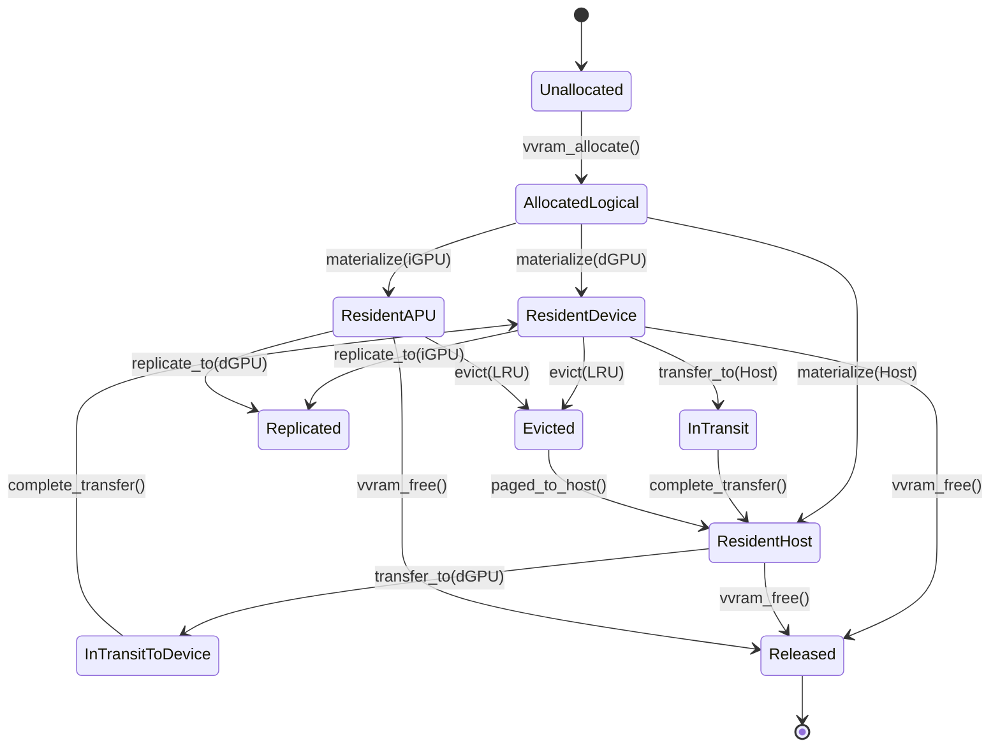

# VVRAM: Virtual VRAM Architecture & Design Specification

**Document Version**: 1.0  
**Status**: Architecture Baseline (Milestone 0)  
**Authors**: OpenMemGPU Systems Architecture Team  

---

## 1. Architectural Mission

**VVRAM (Virtual VRAM)** is the software-managed memory virtualization subsystem of OpenMemGPU.

Its primary purpose is to expose a unified, logical memory management interface to compute and AI inference workloads while rigorously accounting for the physical realities, constraints, and bandwidth asymmetries of heterogeneous GPU and host memory domains.

VVRAM adheres strictly to the **Non-Magic Principle**:
> *VVRAM does not physically combine memory chips or grant infinite bandwidth. It is an intelligent resource coordinator that optimizes data placement, schedules asynchronous staging transfers, evicts inactive pages under memory pressure, and tracks physical memory consumption without double-counting shared backing stores.*

---

## 2. Memory Domain Hierarchy

VVRAM structures the system into three distinct tiers of physical and logical memory:

```
+===================================================================================+
|                              VVRAM LOGICAL ADDRESS SPACE                          |
|                       Virtual Allocations (VvramBuffer / Tensor)                  |
+===================================================================================+
                                         |
               +-------------------------+-------------------------+
               |                         |                         |
               v                         v                         v
       [ Tier 0: Fast VRAM ]    [ Tier 1: APU / GTT ]     [ Tier 2: Host Staging ]
+-----------------------------+-------------------------+---------------------------+
| Physical Discrete VRAM      | APU Shared / GTT Memory | Host System Memory (DDR4) |
| Device: Navi 10 dGPU        | Device: Renoir iGPU     | Device: Host CPU          |
| Capacity: 5.98 GiB          | Capacity: 5.33 GiB (UMA)| Capacity: 14.0 GiB (Total)|
| Bandwidth: ~288 GB/s        | Bandwidth: ~35-42 GB/s  | Bandwidth: ~40 GB/s       |
| Access: Direct GPU Compute  | Access: Shared Infinity | Access: CPU / DMA Staging |
| Latency: < 50 ns            | Latency: ~80-120 ns     | Latency: ~60-80 ns        |
+-----------------------------+-------------------------+---------------------------+
```

### 2.1 The Accounting Hazard: Distinguishing Physical from Logical
A catastrophic design error in heterogeneous GPU memory management is double-counting. VVRAM enforces strict mathematical accounting:

$$\text{Usable Physical RAM} = \text{Total System RAM} - \text{OS Overhead} - \text{iGPU Carveout}$$
$$\text{Total Host Backed Allocation} = \text{System Allocations} + \text{iGPU Allocations} + \text{dGPU GTT Allocations} \le \text{Usable Physical RAM}$$

VVRAM maintains an internal `PhysicalResourceLedger` that ensures total host-backed allocations across all devices never exceed the operating system's available memory budget.

---

## 3. Allocation and Residency State Machine

Every buffer managed by VVRAM progresses through well-defined lifecycle states:



### 3.1 State Invariants
1. **AllocatedLogical**: The allocation has a registered virtual size and layout, but physical GPU memory has not yet been bound (lazy materialization).
2. **ResidentDevice**: The buffer is bound to a `VkDeviceMemory` allocation in dedicated dGPU VRAM.
3. **ResidentHost**: The buffer resides in host-visible, CPU-cached system RAM (acting as an eviction cache or staging source).
4. **ResidentAPU**: The buffer is bound to the integrated GPU's address space.
5. **InTransit**: An asynchronous DMA copy is currently underway. Access to the buffer is fenced by a `VkSemaphore` (timeline semaphore).
6. **Replicated**: The buffer is valid in both dGPU and iGPU memory simultaneously (e.g. read-only embedding matrices or model weight tables).
7. **Evicted**: When memory pressure exceeds a threshold (e.g. 90% of heap budget), least-recently-used buffers are transitioned to Host RAM or disk-backed scratch space.

---

## 4. Workload Placement Policies

When an application requests a VVRAM allocation, the placement policy evaluates:
1. **Compute Locality**: On which device will the compute kernels execute?
2. **Access Frequency**: Is the tensor accessed on every token generation step (e.g. KV cache, attention weights), or only once per prompt (e.g. prompt embedding)?
3. **Bandwidth Sensitivity**: Does the kernel require >100 GB/s bandwidth to avoid compute stall?
4. **Current Driver Budget**: Queried in real-time via `VK_EXT_memory_budget`.

### Placement Policy Matrix
- **Critical Model Weights (Attention QKV, FFN)**: Placed in Tier 0 (dGPU Dedicated VRAM).
- **Secondary Weights (Embedding, Final Layer Norm, Head)**: Placed in Tier 1 (iGPU) or Tier 2 (Host RAM).
- **KV Cache**: Dynamically paged. Active window kept in dGPU VRAM; historical context paged to iGPU/Host memory.

---

## 5. Capacity Reporting Specification

VVRAM rejects single "Total VRAM" counters. The `VvramCapacityReport` API returns:

```rust
pub struct VvramCapacityReport {
    /// Dedicated physical VRAM on discrete GPUs (bytes)
    pub dedicated_vram_total: u64,
    /// Currently allocated bytes in dedicated VRAM
    pub dedicated_vram_allocated: u64,
    /// Live driver budget remaining in dedicated VRAM (VK_EXT_memory_budget)
    pub dedicated_vram_budget_remaining: u64,
    
    /// Host system RAM total capacity (bytes)
    pub host_ram_total: u64,
    /// Live host memory available to OS and user processes
    pub host_ram_available: u64,
    
    /// Shared memory allocated to iGPU / APU
    pub apu_memory_allocated: u64,
    /// Memory used by host staging buffers for cross-device transfers
    pub staging_memory_allocated: u64,
    
    /// Total logical memory managed by VVRAM
    pub logical_vvram_allocated: u64,
    /// Confirmed allocatable capacity verified by test allocations
    pub confirmed_allocatable_capacity: u64,
}
```
